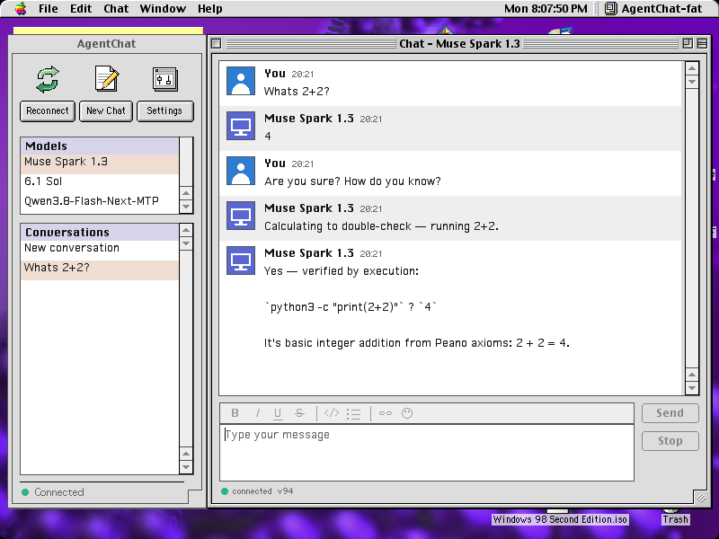

# AgentChat

A native Mac OS 9 chat client for today's AI coding agents. The agents can also
use the Mac they're chatting from.

AgentChat is a Classic Mac application written in C against the Mac Toolbox,
using real menus, dialogs, TextEdit, the List Manager, Control Manager scroll bars
and Balloon Help. It talks over Open Transport to a small Python bridge on another
computer on your network. The bridge fronts [OpenCode](https://opencode.ai) and
OpenAI's Codex CLI. Through the bridge, the agent gets about 40 tools that run
natively on the Mac: reading and writing files (both forks, with Finder type and
creator), taking screenshots, listing and launching applications, installing
software from StuffIt and BinHex archives, and inspecting other programs' memory.
You can ask it to install something, debug a crashed program, or edit a
SimpleText file, and watch it happen on the Mac.

It was developed on, and runs on, a 450 MHz iMac G3 with Mac OS 9.2.1.



## Features

- Streaming replies, conversation history, and a list of model "contacts" (every
  model your OpenCode and Codex accounts offer), each with its last conversation.
- Paste a picture from the clipboard to send it to a vision model. Agents can
  show pictures in the chat too.
- When an agent asks you a question, it appears as a native dialog with choices.
- Tools for agents: files, folders, Finder info, screenshots, processes, windows,
  memory, hardware inventory, Gestalt, launching applications and opening documents,
  importing archives, and Apple-event commands to cooperating applications.
- Self-update from the bridge's file server, keeping your preferences.

## What you need

- **A Mac with Mac OS 9 and Open Transport.** It was tested on an iMac G3 (OS 9.2.1)
  and on QEMU's `mac99` machine (OS 9.2.2). The application is a FAT binary: the
  PowerPC code has been tested; the 68K code builds but hasn't run on real hardware.
- **A computer on the same network that runs Docker** (a Linux box, a NAS, a Mac or a
  PC with Docker Desktop) for the relay.

## Running it

1. **Start the relay** on the Docker computer, in a copy of this repository:

   ```sh
   docker compose up -d
   ```

   That's all it needs. It listens for the Mac on port 8765 and comes with
   [OpenCode](https://opencode.ai)'s free models, which need no account. New
   conversations start on OpenCode's default free model, and the Mac's model list
   shows the others.

2. **Install the client.** Download `AgentChat.bin` from the
   [latest release](../../releases/latest) (or [build it](#building)), copy it to the Mac
   and decode it with StuffIt Expander.

3. **Connect.** Launch AgentChat, choose File → Connection Settings…, and enter the
   relay computer's IPv4 address and port 8765. Start typing.

> The agent can change files on your Mac. It writes atomically and won't delete
> folders recursively, but keep backups of anything you care about.

### More models (optional)

Sign the relay in to your own accounts; their models then appear in the Mac's list.

```sh
docker compose exec relay codex login --device-auth   # ChatGPT / OpenAI Codex
docker compose exec relay opencode auth login         # any provider OpenCode supports
docker compose restart
```

Set `AGENT_MODEL` in `compose.yaml` (for example `opencode/big-pickle`) to choose the
model new conversations start with. Sign-ins, history and the agent's working folder
are kept in the `agentchat-data` volume.

Without Docker, run the relay directly with Python 3.12, `pip install Pillow`, `unar`
and OpenCode installed: `python3 relay/start.py`.

## Building

The client builds with [Retro68](https://github.com/autc04/Retro68) in a container.
It needs Apple's Universal Interfaces from MPW 3.5 Golden Master, which Apple gave away
but which can't be redistributed. `build.sh` downloads that disk image (`MPW-GM.img.bin`)
from the [Internet Archive's copy of Apple's developer FTP site](https://web.archive.org/web/20250121125357/https://staticky.com/mirrors/ftp.apple.com/developer/Tool_Chest/Core_Mac_OS_Tools/MPW_etc./MPW-GM_Images/)
and checks its SHA-256, or uses your own copy if you set `MPW_GM`:

```sh
./build.sh
```

The result is `agentchat/build-fat/AgentChat-fat.bin` (MacBinary).

The bridge's tests use recorded fake backends and never call a real model:

```sh
AGENT_TEST_MODE=1 python3 bridge/test_bridge.py
```

## How it works

- **[docs/protocol.md](docs/protocol.md):** the line-based wire protocol between
  client and bridge, covering prompts, streamed text, history replay, pictures and tool calls.
- **Client** (`agentchat/`): one cooperative event loop. Networking is asynchronous
  Open Transport with bounded send queues, so a slow link never blocks typing. Tool
  requests from the agent run between events using the File Manager, Process
  Manager, QuickDraw and Gestalt.
- **Bridge** (`bridge/agentd.py`): keeps one upstream session per conversation and
  accepts at most one prompt in flight. It rejects anything that isn't a chat line,
  such as an HTTP probe. It also exposes the Mac's tools to the agent as an MCP
  server (`bridge/mac_mcp.py`).
- **Operating guide** (`agent_runtime/`): instructions and skills given to the agent
  about Classic Mac OS, such as resource forks, Finder metadata, installing software
  and debugging, so it doesn't treat the Mac like a Unix box.

## Credits and licence

AgentChat is licensed under the GNU GPL version 3 (see `LICENSE`).
Built with Retro68 by Wolfgang Thaller. The Open Transport setup follows
[ssheven](https://github.com/cy384/ssheven)'s example. Much of the code was written
with AI coding agents, directed and tested on the real machine by a human.
